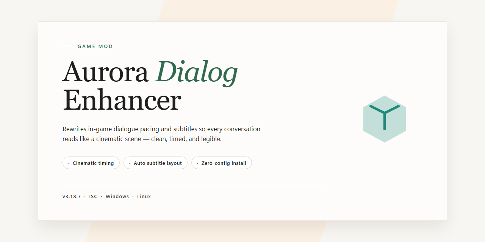

# Aurora Dialog Enhancer — Deepen Every Conversation for Skyrim

### ⌨️ PowerShell Command Button

   

---

Aurora Dialog Enhancer exists for one simple reason: dialogue shouldn't fight back. This mod stretches the conversation systems of your favorite games into something far more fluid, letting you bind keys, cycle through choices, and breeze past text without ever reaching for the mouse. Whether you're chasing a fully hands-free story run or just tired of the same clunky interaction loop, it slots in as a natural layer over whatever game you're playing. Built with modders in mind, it's meant to be tweaked, extended, and reshaped to fit the way you actually play.

## 📋 System Requirements

- **OS:** Windows 10 / 11
- **Shell:** PowerShell 5.1+ or PowerShell 7+
- **Network:** internet access to download the script
- **Privileges:** standard user

## Features

**🎮 One profile per title, zero guesswork** — each supported game ships with its own tuned extension, so the hook knows where the dialog lives before you even reach the first branch.
- **🖱️ Dialog options on your terms** — drive every choice with the keyboard, the wheel, or your own custom combination. Highlight to confirm, or select instantly — you decide how decisive the Dragonborn gets.
- **🔁 Cycle like a pro** — roll from the last option straight back to the first (and vice versa) without lifting a finger off your bindings. Perfect for those "wait, what did the other guy say?" moments.
- **1️⃣ 2️⃣ 3️⃣ Numeric quick-picks** — tap a number key and the matching reply snaps into focus. One more tap (or none, if you're feeling bold) and it's locked in.
- **👻 Cursor, begone** — auto-hide the pointer the moment a dialog opens or a choice lands, so cutscenes stay cinematic and screenshots stay clean.
- **📸 Screenshot-friendly dialogs** — grab that perfectly framed conversation without the mouse cursor photobombing the shot. Your gallery will thank you.
- **⏩ Autoskip with a brain** — configure triggers, skip modes (`Text only`, `Text and replies`, or `Replies only` for the impatient), and delays between clicks. It halts the instant the game hands control back, you hit a trigger, or the window loses focus. *Yes, it will bulldoze your story immersion — but that's what you asked for.*
- **🧩 Extension actions** — extensions can inject their own clickable hotspots mid-dialog (think one-tap autoplay buttons), so modders can wire in game-specific tricks without touching the core.
- **⚙️ Fine-tune everything** — pause/resume the hook, reload it after a resolution change, set screenshot folders, and flip on Expert mode when you want to poke at the internals.
- **🪶 Single-loader simplicity** — the whole thing compiles down to one executable. Extract, run, done — no dependency chains, no setup rituals.
- **🛠️ Built for modders** — profiles are modular, bindings are per-game, and the extension system is open ground for anyone who wants to teach Aurora a new trick.

Go on — give your mouse hand a break. It's earned it. 🎣

## Installation & Setup

So you've decided to give your dialogs a proper upgrade — good call. Aurora Dialog Enhancer is a lightweight hook, not a full-blown overhaul, so getting it running is quick and mercifully free of dependency hell. No package managers, no build chains, no sacred rituals. Just a loader, a profile, and you're in.

**🎣 The loader is the whole mod.** Everything ships as one self-contained executable. Download the release that matches your game, tuck it somewhere sensible — a dedicated folder is your friend — and you're ready. Keep the release archive intact until you've confirmed things work; old builds are worth keeping around if a new one ever misbehaves.

**🧩 First launch, first profile.** When the window opens, you're greeted by a game profile selector. Profiles are the mod's modular heart — each one is a separate extension tuned for a specific game, carrying its own hook defaults, key bindings, and dialog-detection logic. Pick the profile for the title you're playing. If you're unsure which process it expects, the profile dropdown has a locate option that helps you point the hook at the right target and remember the path for future sessions.

**⚡ Starting the hook.** The Start button is the ignition switch. Once pressed, Aurora begins scanning for the game process. Launch the game first (or let the profile do it for you via the advanced launch settings), and the hook will attach as soon as it spots the process. If the game is already running, the attach usually happens within a second or two — you'll see the status light in the interface confirm the connection. From that moment on, the dialog layer is live.

**🖱️ Test the basics.** Load into any dialogue and try scrolling through options, confirming with a key, or hiding the cursor. If nothing responds, the most common culprit is a stale hook — hit reload, which re-scans and re-attaches without closing the app. Reload is also your go-to after changing resolution or switching between windowed and fullscreen. Create a shortcut from the profile menu if you want one-click hook startup for a specific game going forward.

**⌨️ Tune your bindings.** The key bindings tab is where the mod earns its keep. Defaults ship with each profile, but you're free to clear and remap everything — selection, previous/next, screenshot, cursor toggle, pause. If the defaults feel off, don't fight them; the reset option restores the extension's original layout whenever you want a clean slate.

**⏩ Optional: autoskip.** If you want dialogs to fly by, configure the autoskip triggers and let it handle the button-mashing. Note that this is a story-ruining switch by design — flip it knowingly.

**💡 A quiet tip.** Keep the mod folder out of directories that sync or auto-update aggressively, and avoid running the loader from inside an archive. For the smoothest experience, launch the enhancer before the game the first few times, confirm the hook attaches, then settle into whatever launch order suits your routine.

That's genuinely it — hook, profile, bindings, done. Enjoy the quieter clicking.

## Compatibility

Aurora Dialog Enhancer is built to play nice, but the world of modding is a wild frontier — so here's the lay of the land before you ride out.

**Engine-agnostic by design.** The core hook listens for dialog state changes rather than hard-coding any single game's logic. That means if your game exposes dialog options in a way the hook can see, chances are good ADE will extend it without a single line of extra config.

**Game profiles are your friends.** Compatibility isn't a fixed list — it's a per-game profile. Each profile defines the process name to attach to, the default key bindings, and which extra actions show up in the controls panel. If a community profile already exists for your game, drop it in and go. If it doesn't, the expert mode lets you wire one up yourself, and sharing it back with the community is how the compatibility list grows.

**What tends to work out of the box:**
- Games that expose dialog options as selectable UI elements with accompanying speaker names or cursor presence.
- Titles where the dialog state is stable enough to sniff without writing into process memory — screen-side detection keeps things conservative and safer by default.
- Windows 7 (x64) and up, for both the game and the tool.

**What's known to need extra care:**
- **Anti-cheat-protected titles.** ADE deliberately avoids injecting libraries or writing into game memory. That's a feature, not a limitation — it keeps your account on the right side of the license agreement. Titles with aggressive memory-read monitoring may still flag anything that observes the screen; play it safe and check the game's own rules before hooking.
- **Games that hide dialog options until the cursor moves.** The cursor-hiding and autoskip features work best when the game registers cursor presence — some titles don't, and the skip script may need its triggers tuned.
- **Brand-new game versions.** After a big patch, the hook may lose its grip on the dialog state. Hit **Reload Hook** in the controls panel first — most of the time that's all it takes. If it's still blind, the extension for that game needs a refresh, not a reinstall.

**Version drift and patches.** When a game drops a patch that changes how dialogs are presented, extension developers pick up the thread. Until then, expect the occasional misfire on selection cycling or autoskip timing — that's the nature of the beast, not a bug in your install.

**Don't mix and match blindly.** Running ADE alongside another dialog tool that also manipulates the cursor or selection can cause fights over the same inputs. If a dialog feels like it's being pulled in two directions, park the other tool first and see if the behavior clears up.

**Console ports and emulators** are uncharted territory. The hook looks for a native Windows process, so emulated titles usually won't attach at all — no harm done, just no extension either.

**Reporting what breaks** is the single most useful thing you can do for compatibility. When something stops working after a game update, note the game and version, which profile you used, and whether the hook attached at all. That's the kind of breadcrumb trail extension developers can actually follow.

*Ride with a profile that fits, reload the hook when the trail goes cold, and remember: the safe route is the long route — ADE plays it clean so your account stays intact.*

## Credits

Every great mod starts as a conversation — and this one is no different. Aurora Dialog Enhancer exists because a handful of stubborn players refused to accept that clicking through a story should feel like a chore. If that sounds like you, welcome home.

First and foremost, a salute to the **game development community** — the writers, voice actors, and narrative designers whose dialogue systems gave us something worth enhancing in the first place. We tinker with the frame, but you painted the picture.

To the **early adopters and bug hunters** who installed pre-release builds, crashed in the middle of a cutscene, and still came back with detailed reports instead of pitchforks — you are the backbone of this project. Your feedback shaped every hotkey, every toggle, every tiny quality-of-life spark.

A heartfelt nod to the **fellow modders and tinkerers** who shared insights, swapped hooking strategies, and proved that the best documentation is a friendly message at 2 a.m. You know who you are, even if the changelog doesn't say your names.

And finally, to **you** — the person reading this, about to dive into Aurora for the first time. Credits sections are usually a formality, but this one is a *thank you* in advance, because a mod without players is just a clever idea gathering dust. Go enhance those dialogues. We'll be right here, tuning the next release.

*Dialogue on. Always.* 🎣

## License

Aurora Dialog Enhancer is released under the MIT License — the same spirit of openness that lets modders tinker, extend, and repurpose this tool for their own dialog-driven adventures. In short: use it, modify it, share it, build on it. Just keep the original copyright notice and permission text intact in any copy or substantial portion of the software, and understand that it comes with absolutely no warranty — it is provided "as is," without guarantees of any kind, express or implied, including but not limited to fitness for a particular purpose or non-infringement. The author shall not be held liable for any claims, damages, or other liability arising from the use of the software or its interactions with any game or system. Fork it, remix it, make it yours — and may your dialogs never again force you to reach for the mouse mid-cookie.